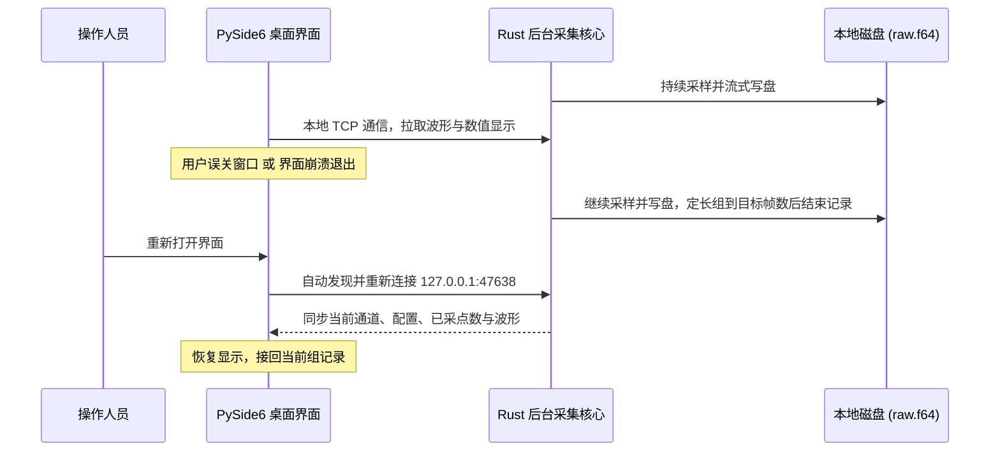

# LabDAQ 用户使用指南（开发稿）

本指南面向实验室操作人员，介绍 LabDAQ 中文桌面数据采集系统的界面布局、常规实验步骤、电信号模拟与 HPF 回放配置、数据导出及容灾续录特性。

当前软件尚在开发，本手册随界面实现更新。已支持独立 USB 连续采集、软件模拟和部分历史文件输入；后续一般功能开发默认使用独立软件模拟，设备可以关闭。源码运行方式见[开发环境说明](../开发文档/开发环境.md)。

日常记录、回看、统计与导出流程已贯通，支持暂停/继续记录、双游标、图横轴切换、实时读数设置和记录库批量导出。基础 AO 输出已加入，并于 2026-10-20 通过物理回接 AI0 的低幅值短测；仪器校准待信号发生器、示波器到齐后再安排。

---

## 一、 界面概览

软件主界面包含五个导航页面，日常实验主要在 **“实时采集”** 页进行：

```text
┌──────────────────────────────────────────────────────────────────────────────┐
│ ┌────────────┐ 实时采集                                      [模式徽标]        │
│ │ LabDAQ     │ 连接设备，配置采集参数，实时查看多通道信号波形与数值。           │
│ │            │ ┌────────┐ ┌────────┐ ┌────────┐ ┌────────┐  ┌─────────────┐ │
│ │ 实时采集   │ │ AI 0   │ │ AI 1   │ │ AI 2   │ │ AI 3   │  │ 采集参数     │ │
│ │ 信号输出   │ │ 37.632 │ │ 12.946 │ │ -4.721 │ │ 28.306 │  │ 通道与传感器 │ │
│ │ 信号分析   │ └────────┘ └────────┘ └────────┘ └────────┘  │ 配置与存储   │ │
│ │ 数据回看   │ ┌────────────────────────────────────────┐  └─────────────┘ │
│ │ 设备与协议 │ │ 实时波形    [保存图像] [适应窗口]       │                    │
│ │            │ │ 时间轴 · 读数 · 小数位 · 暂停滚动       │                    │
│ │            │ │           实时波形曲线显示区            │                    │
│ │            │ └────────────────────────────────────────┘                    │
│ │ DT9837C    │ [开始预览] [开始记录] [暂停记录] [停止采集]   状态 · 计数      │
│ │ 设备状态卡 │ 状态提示条                                                    │
│ └────────────┘                                                              │
└──────────────────────────────────────────────────────────────────────────────┘
```

- **左侧导航栏**：实时采集、信号输出、信号分析、数据回看、设备与协议；底部设备状态卡显示 DT9837C 型号、USB 连接状态和采集核心状态。
- **顶部标题区**：当前页面标题、说明文字，以及右上角的工作模式徽标（独立核心模拟、HPF 回放、真实 USB 输入等）。
- **指标卡区**：显示各通道名称、读数与单位，可选近一秒最新值、首值、均值、最小值、最大值、RMS、标准差或峰峰值，并设置 0–9 位小数；卡片内迷你趋势线帮助判断信号是否在变化。
- **波形卡片**：实时绘制启用通道的信号波形；卡片顶部提供“保存图像”“适应窗口”，下方一行是“时间轴”“读数”“小数位”和“暂停滚动”。勾选“暂停滚动”只冻结曲线，读数仍会更新，采样和记录继续。
- **实时采集右侧参数区**：按“采集参数 / 通道与传感器 / 配置与存储”分成三张可折叠卡片，点击标题可展开或收起。AO 控件位于左侧第二项“信号输出”页面。
- **底部命令条**：预览、开始/结束记录、暂停/继续记录、停止采集，右侧显示当前状态与扫描计数/时长。
- **底部状态提示条**：显示当前操作结果、记录路径和需要注意的限制。

---

## 二、 实验操作四步工作流

完成一次实验记录的标准流程如下：

```text
步骤 1: 配置实验参数 ──► 步骤 2: 开始预览与检查 ──► 步骤 3: 按需调零与开始记录 ──► 步骤 4: 结束并导出数据
```

### 步骤 1：配置实验参数

1. **设置实验名称**：在右侧“采集参数”卡片输入名称（如 `拉伸试验_组01`）。名称用于记录文件夹、每天的分组编号和实验元数据，不改变采样或传感器参数。
2. **连接设备**：软件启动时自动扫描 DT9837C，发现后连接并保持绿色待机，不自动开始采集。未检测到设备或拔插后，点击左下设备卡片的“重新连接”。采集页不提供模拟来源和电信号配置入口；历史 HPF 在“数据回看”中打开。
3. **设置采样率**：从下拉框选择每通道采样率，默认 **5 kS/s**；提供 0.5、1、2、5、10、20、50、100 kS/s 常用档位。5 kS/s 结合当前放大器 200 Hz 低通配置，兼顾时间细节与数据量；需要测量更快的信号时再提高。开始后显示 PLL 计算的名义采样率，实际计算和记录使用该值。
4. **配置通道参数**：
   - 在右侧“通道与传感器”卡片点击 **“编辑通道与传感器”**，打开配置弹窗；
   - 勾选需要启用的通道（如 AI0–AI2）；
   - 填写通道名称（如法向力、切向力）、单位（如 `N`）、灵敏度（`mV / 单位`，例如 `500` mV/N）；
   - 选择量程（`±10 V` 或 `±1 V`）与耦合方式（`DC` 或 `AC`）。完成后点击“应用设置”。HPF 模式会锁定这些参数。
5. **设置本组记录**：底部操作栏直接选择“记录时长”：手动结束、10 秒、30 秒、1 分钟、5 分钟、10 分钟或自定义秒数。不再填写备注。达到目标帧数后自动保存并继续预览；目标按实际采样率四舍五入到整数帧，暂停期间不累计记录时长。
6. **保存/载入预置**：
   - 展开右侧“配置与存储”，将采集参数、记录时长、横轴显示时长、读数模式和显示小数位保存为 JSON；载入时恢复。

### 步骤 2：开始预览与检查

- 先确认左下显示 **“USB 已连接 · 待机”**。软件启动自动连接，拔插后点该卡片的“重新连接”；待机时不产生扫描或记录。设备连接完成后才可开始预览或记录。
- 点击底部命令条的 **“开始预览”** 按钮。
- 此时命令条右侧显示“预览中 · 未记录”，顶部数值卡与波形图开始实时刷新；
- 真实设备正在采集时，本机实测 LED 为橙色常亮；预览也属于采集。
- 点击波形卡片右上角的 **“适应窗口”**，可自动调整坐标轴范围。

波形卡片下方的 **“时间轴”** 可选择相对时间、绝对时间（电脑时钟）或样本号。绝对时间根据电脑记录的采集起点换算，以本地时间显示；它不代表独立硬件同步时间。没有可用起点时间的 HPF 使用相对时间，不用文件修改时间代替。

**“读数”** 控制指标卡的取值方式。首值是当前近一秒缓冲中的第一个样本；标准差使用总体标准差。旁边的“小数位”只影响显示，不改变记录或导出值。

“小数位”旁的 **“窗口”** 设置横轴显示秒数，默认 10 秒。开始时曲线从左侧增长，满窗后才滚动；手动缩放后暂停自动跟随，点击“适应窗口”恢复。窗口最长 60 秒，另受每通道 200,000 点显示缓存限制，当前可填上限随采样率调整；这不限制记录时长。

各通道数值卡右上角的 **“显示 / 隐藏”** 开关可直接控制主界面曲线的显隐，不改变通道采集、数值卡或文件记录；未启用的通道不提供此开关。“暂停滚动”只冻结实时图。

**测量游标移至“信号分析”**，默认分析类型为“时域波形 / 测量游标”。选择分析通道、勾选游标后，拖动 A、B 竖线读取真实样本的时间、幅值、Δt、Δy 和区间峰峰值。“冻结测量窗口”方便读数，采集和记录继续；`1/|Δt|` 仅为间隔倒数，不代表自动测得的基频。需要频域结果时，在“分析类型”中切换幅值谱、PSD 或 H1。

拔掉 USB 后，软件会更新连接状态并显示顶部红色提示；重新插入后点击设备卡片的“重新连接”，成功后恢复待机，需要再次手动开始预览或记录。

### 信号输出与 AO→AI0 回环

点击左侧第二项 **“信号输出”**，设置直流、正弦、50% 占空比方波和三角波。页面切换不改变采集或输出状态。

1. AO 通过 BNC 线接 AI0。通道设置中启用 AI0，选择 **DC、关闭 IEPE、±10 V、单位 V、零点 0**，便于直接观察原始电压。当前回环模式禁止 AI0 开启 IEPE 时启动 AO。
2. 连接设备并开始预览，AI 默认 5 kS/s 可观察低频信号。
3. 设置波形、峰值幅度、偏置、频率及 AO 更新率，点击 **“开始输出”**。初始值为 10 Hz 正弦、0.2 V 峰值、0 V 偏置、48 kS/s 更新率。直流电平由“偏置”设置。
4. **“停止并归零”** 下发 0 V，AI 预览和记录继续；底部 **“停止采集”** 同时停止 AO 并下发 0 V。结束一组记录、暂停记录或定长记录完成都不停止 AO。输出运行时参数锁定，先停止再修改。

输出范围为 ±3 V，偏置绝对值加峰值幅度不得超过 3 V；峰峰值为峰值幅度的两倍。AO 更新率范围为 10–96 kS/s，与 AI 采样率独立。周期波形频率必须低于实际 AO 更新率的一半；接近此边界时波形会受 DAC 滤波和采样点数限制，方波边沿也会产生滤波过冲。回读时 AI 采样率应足以覆盖信号频率。

**关闭窗口后，独立核心仍继续采集与输出。** 重开界面可接回实际状态。保存/载入实验配置包含 AO 参数，载入不会自动开始输出。记录保存起始 AO 状态与期间启停事件；事件中的扫描位置只是软件观察位置，不表示 AI/AO 硬件同步或群延迟补偿。

回环实测确认了基础功能、更新率边界和停止归零。回读存在幅值和零点偏差，未做软件补偿；短测不代表独立精度校准或长时间运行验证。扫频、噪声、Burst 和硬件同步触发尚未实现。

### 步骤 3：按需调零与开始记录

1. **载荷调零（可选）**：
   - 若传感器在初始状态下存在静态偏移，在实时波形卡片顶部点击 **“当前载荷归零”** 按钮；
   - 软件使用最近最多 1 秒的平均电压作为零点；可在 USB 预览中操作，记录期间不可用。开发用 HPF 输入会锁定调零；
   - 调零改变显示和派生换算，原始电压保持不变。开始下一组不会自动调零；
   - 需要恢复时点击旁边的 **“撤销调零”**，只撤销最近一次调零。记录期间不可撤销。
2. **开始记录**：
   - 点击底部命令条的 **“开始记录”** 按钮；
   - 按钮将切换为红色高亮的 **“结束记录”**，状态显示为“正在记录”，命令条开始显示本组扫描数与时长；记录期间底部显示本组扫描数和时长；未记录时显示本次预览累计扫描数和时长；
   - 每次记录自动创建新的编号组；定长记录还会显示剩余秒数；当前正式界面不填写单组备注；
   - *提示：也可以在未开始预览的状态下直接点击“开始记录”，系统会自动开启采样并从第 0 帧开始完整记录。*
3. **暂停与继续本组记录（可选）**：
   - 点击 **“暂停记录”** 后，本组停止写入，输入、预览及实时读数继续；已记录帧数和定长剩余量不变；
   - 点击 **“继续记录”** 后接着写入同一组，暂停期间的源扫描位置保留为时间缺口，不将两段拼成连续时间；
   - 暂停中也可直接结束本组或停止采集。波形卡片中的 **“暂停滚动”** 仅冻结曲线显示，操作它不会暂停写盘。

### 步骤 4：结束记录与数据收尾

1. **结束当前组记录**：
   - 手动记录在实验完成后点击 **“结束记录”**；定长记录达到目标帧数后自动结束，也可提前手动结束；
   - 软件关闭当前记录并保存结束信息，波形继续预览，可以直接开始下一组。数据在记录期间已经持续写入。
   - 记录只保存实际取得的样本；来源结束或采集异常会按实际原因收尾，不会为凑够记录时长补造样本。
2. **完全停止采集**：
   - 点击 **“停止采集”** 按钮，停止输入和当前记录。
   - 真实 USB 输入保持设备连接和工作电源，返回绿灯；需要关闭工作电源时，再点击右侧“采集参数”卡片中的 **“断开设备”**。未采集时关闭程序也会断开设备。

---

## 三、 特色机制：独立核心与容灾续录

正式界面使用“DT9837C · 真实 USB 输入”。开发测试使用的“独立核心 · 电信号模拟”与 USB 输入一样，采样进程独立于界面：



### 1. 为什么关闭窗口后记录仍在进行？

- 采集与写盘由独立的后台进程 `labdaq-core.exe` 承担；
- Qt 界面仅是一个“观察者与控制器”，通过本机 TCP（端口 `47638`）与核心通信；
- 核心不依赖 GUI 刷新来采样或写文件。模拟样本的时间轴按样本序号和名义采样率计算，生成节奏由系统计时器安排。
- 定长记录由核心按已记录帧数结束；即使 GUI 已断开，达到目标后仍会关闭当前文件并继续预览。重新打开界面可看到结束状态和记录位置。

### 2. 真实场景应对

- **意外关闭或闪退**：后台继续采集，手动组持续记录，定长组达到目标后自动结束记录；重新打开界面可接回核心，恢复当时的通道名、灵敏度、零点及波形。
- **如何彻底退出核心？**：
  - 正常停止：必须在界面上先点击 **“停止采集”**，然后再关闭窗口，此时后台核心会自动安全退出；
  - 若在采集中直接关闭了窗口，核心会保持运行以保护数据。

> [!WARNING]
> **容灾续录范围说明**：
> 当前续录机制适用于 **Rust 独立核心的电信号模拟与 USB 输入**。旧协议模拟和 HPF 回放仍在 GUI 进程内。此前已验证 GUI 退出后的续录；本轮分组定长功能使用模拟信号验证，USB 共用核心实现，未做本轮实机验证。小时级运行、核心进程崩溃、系统故障或断电后的恢复尚未验证。

---

## 四、 输入模式与开发边界

正式采集页只提供 **DT9837C 真实 USB 输入**，不显示输入来源选择、可配置电信号或“把 HPF 作为采集输入”的入口。当前代码仍保留这些模拟/HPF 采集输入供软件开发和回归测试使用，不作为正式用户操作功能；最终交付时将删除相应开发入口，而不是仅隐藏。

普通用户需要查看 HPF 时，请在 **“数据回看”** 页点击 **“打开 HPF”**。当前支持已核实的 DT9837C 力记录及同步 Double/V 类型，未知结构会明确拒绝；只读回看不会改变原文件，具体浏览方法见下一节。

开发输入的波形、参数和验证边界见[力信号输入与模拟开发边界](../功能实现/signal-input.md)，开发启动方式见[开发环境与源码运行](../开发文档/开发环境.md)。

---

## 五、 数据存储、回看与导出

### 1. 数据落盘结构

每次记录默认在 `recordings/` 下按日期、实验名和组号创建文件夹，也可通过“更改目录”选择保存位置。同一日期和实验名按已有组号继续递增，不覆盖已有目录；日期或实验名变化后各自计数：

```text
recordings/
└── 20261019_力传感器实验_001/
    ├── raw.f64         # 原始电压二进制流（IEEE 754 64位浮点，小端字节序）
    └── metadata.json   # 实验元数据（采样率、通道配置、换算系数、历史/开发备注、记录时长、启停与结束信息）
```

记录还会保存输入来源：开发合成信号为 `simulation`，开发 HPF 输入为 `file_replay`，真实 USB 输入为 `usb`。当前正式界面不填写新备注；记录格式仍支持备注，历史或开发记录含有备注时会在记录库显示。暂停/继续记录后，元数据的 `recording_segments` 保存各段的原始扫描位置；原始文件只存实录样本，不填充暂停区间。定长记录按实录帧数结束；开发用单次 HPF 输入以目标帧数或文件末尾先到者为准。采样和写盘异常会报告原因；不要将 GUI 退出后的续录能力理解为核心故障或断电时的数据完整性保证。

“配置与存储”卡片中的记录目录下方每 5 秒刷新所在磁盘的可用空间，单位为 GiB；该显示只读取空间信息。

### 2. 数据回看操作

切换至主界面的 **“数据回看”** 页面。页面顶部是文件操作（记录库、打开记录、打开 HPF、最近记录）和文件信息；中部是波形卡片，波形下方依次是播放定位、选区和游标控制。

1. 点击 **“记录库”** 查看当前记录根目录下的各组。列表按本地开始时间排序，显示实验、备注和结束状态；搜索框匹配实验名、备注、目录名或结束状态，也可输入目录日期（如 `20261019`）查找，双击一行打开。Ctrl/Shift 可多选记录进行批量导出，“打开”仍只打开当前组。列表只读元数据，不整体读取原始波形。也可用 **“打开最近记录”**、**“打开记录文件夹”** 或 **“打开 HPF”**。
2. 调整 **“显示时长”**，用滑块粗略定位，或在 **“起点”** 输入秒数精确跳转；起点支持 9 位小数，并按实际样本位置显示。**“上一窗口”**、**“下一窗口”** 连续浏览相邻区间。每次最多读取 200,000 样本，长记录不整体载入内存。
3. 在 **“显示与取数通道”** 勾选物理 AI 通道；勾选同时控制波形显隐、统计和导出。
4. 需要统计或导出一部分数据时，勾选 **“使用选区”**，填写起止秒数，或拖动图中的蓝色区间；**“选当前窗口”** 可直接选中当前显示范围。选区按最近样本边界取整，左端包含、右端不含。暂停缺口内的边界定位到下一段实际样本。未勾选时，统计和导出处理全记录，即使图中只显示一个窗口。
5. 回看页的 **“时间轴”** 可切相对时间、绝对时间（电脑时钟）或样本号，**“起点”及选区起止字段始终填写相对秒数**。暂停区间以曲线断线显示，不跨缺口连线或补点。勾选图下方 **“测量游标”**，选择通道即可读取 A/B、Δt、Δy、区间峰峰值及间隔倒数，操作与实时图相同；游标不改变统计/导出的蓝色选区。
6. 点击 **“分析此窗口”**，可将当前显示窗口送入“信号分析”页；这一入口使用显示窗口。包含暂停缺口的窗口不能做 FFT 等连续信号分析，请先定位到一个连续记录段。

### 3. 统计所选数据

点击 **“统计所选数据”**，在弹框中选择原始 V 或工程值，查看勾选通道在所选区间内的最小值、最大值、峰峰值、均值、总体标准差和 RMS。多通道统计表可复制；未启用选区时计算全记录。跨暂停区间统计只聚合实际记录样本，不为暂停时间补零或插值。后台统计显示进度，可点击 **“取消统计”**；取消后不会显示不完整结果。

### 4. 导出 CSV/TXT 与保存图像

在“数据回看”页面点击 **“导出数据”**：

- 选择 CSV（逗号分隔）或 TXT（制表符分隔），数值可选原始 V、工程值或两者；导出使用勾选通道及当前选区，未启用选区时使用全记录。
- 时间列可选秒（`time_s`）、毫秒（`time_ms`）、微秒（`time_us`）或样本号（`sample_index`）。四种格式均保留相对于原记录的源扫描位置及暂停缺口，不将选区起点重新归零。
- 导出在后台分块读取并显示进度。点击 **“取消导出”** 或关闭运行中的对话框会请求取消，在当前数据块结束后停止；取消不记为成功，若目标文件只写出一部分，界面会明确提示。
- 文件首行附带 JSON 元数据注记，保留原配置，并在 `export` 中说明区间、导出样本数、物理通道、数值类型和时间格式。

以下是格式示例，两路均按 500 mV/N、零点为 0、无反向换算，元数据已简写：

```csv
# labdaq_metadata: {"format": "labdaq-raw-voltage", "sample_rate": 2000.0, ...}
time_s,切向力[AI0]_raw_V,法向力[AI1]_raw_V,切向力[AI0]_N,法向力[AI1]_N
0.000000,0.125000,0.450000,0.250000,0.900000
...
```

实时采集和数据回看页的 **“保存图像”** 将当前波形图保存为 PNG；不包含原始波形数据。

### 5. 批量导出多组记录

在 **“记录库”** 中按 Ctrl/Shift 多选已经收尾且无采集异常的记录，点击 **“批量导出”**，选择 CSV/TXT、原始电压/工程值/两者及四种时间列格式，再选输出目录。每组按记录目录名生成一个文件，导出该组全部实录样本及它自身的全部通道，不使用回看页的通道勾选或选区。

已有同名目标文件时会提示更换目录，不覆盖文件。记录仍在进行、存在采集异常或未正常收尾时不能批量导出；活动组先结束，异常组可单独打开并导出可读完整帧。批量任务在后台逐组分块执行并显示总进度，出错会指出失败组并保留已成功的文件。点击 **“取消导出”** 或关闭运行中的对话框会请求取消；取消后仅已完成组计为成功，当前组可能留有不完整输出，应按界面提示检查。

---

## 六、 常见问题排查（FAQ）

### Q1: 软件调零后，之前记录的数据会变吗？
**不会。** 软件调零改变显示和换算参数，不改原始电压文件。已有记录保留记录时的换算配置，新零点用于之后的记录。

### Q2: 误关了界面窗口，怎么接回正在进行的实验？
独立核心模式下，重新打开界面即可。界面读取本机连接信息并接回同一会话，恢复波形、配置及已采和已记录帧数。若显示“核心连接中断 · 状态未知”，表示暂时无法确认核心状态，不等于记录已经停止。

### Q3: 导出的 CSV 文件如何在 Python / pandas 中直接读取？
由于 CSV 首行包含了以 `#` 开头的元数据注记，在 Python 中使用 pandas 读取时，只需指定 `comment='#'` 即可无缝解析：

```python
import pandas as pd

df = pd.read_csv("export.csv", comment="#", encoding="utf-8-sig")
print(df.head())
```

### Q4: 界面显示的“实际时钟”为什么和填写的略有微小差异？
USB 与开发模拟模式都使用公开实现中的 PLL 算法计算名义采样率。例如请求 1000 S/s，计算值约为 1000.116 S/s。这个数值用于样本时间轴，不是实测硬件时钟；开发用 HPF 输入直接使用文件保存的采样率。
