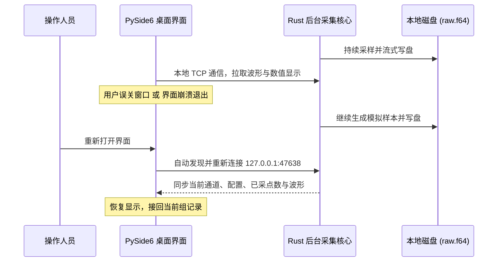

# LabDAQ 用户使用指南（开发稿）

本指南面向实验室操作人员，介绍 LabDAQ 中文桌面数据采集系统的界面布局、常规实验步骤、电信号模拟与 HPF 回放配置、数据导出及容灾续录特性。

当前软件尚在开发，本手册随界面实现更新。已支持独立 USB 连续采集、软件模拟和部分历史文件输入；后续一般功能开发默认使用独立软件模拟，设备可以关闭。源码运行方式见[开发环境说明](../开发文档/开发环境.md)。

---

## 一、 界面概览

软件主界面包含四个导航页面，日常实验主要在 **“实时采集”** 页进行：

```text
┌────────────────────────────────────────────────────────────────────────┐
│  LabDAQ · 实验采集原型                   [● 独立核心模拟 · 非真实测量] │
├───────────┬──────────────────────────────────────────────┬─────────────┤
│  导航菜单 │  AI 0 指标卡    AI 1 指标卡    AI 2 指标卡   │  本次实验   │
│           ├──────────────────────────────────────────────┤  输入来源   │
│  实时采集 │                                              │  采样率     │
│  信号分析 │               实时波形曲线显示区             │  通道配置   │
│  数据回看 │          (支持鼠标平移、滚轮缩放、自适应)    │  载荷调零   │
│设备与协议 │                                              │  保存/载入  │
├───────────┴──────────────────────────────────────────────┴─────────────┤
│  [开始预览]   [● 开始记录 / ■ 结束记录]   [■ 停止采集]        状态与计数│
└────────────────────────────────────────────────────────────────────────┘
```

- **顶部状态栏**：当前工作模式标记（如独立核心模拟、HPF 回放等）。
- **指标卡区**：顶部实时显示各通道最新读数与单位。
- **波形图表区**：实时绘制启用通道的信号波形；勾选“暂停滚动”只冻结曲线，读数仍会更新，采样和记录继续。
- **右侧参数面板**：设置实验名称、输入来源、每通道采样率、通道物理参数以及保存/载入配置。
- **底部控制工具栏**：核心操作按钮（预览、记录、停止）与当前记录状态/扫描点数统计。

---

## 二、 实验操作四步工作流

完成一次实验记录的标准流程如下：

```text
步骤 1: 配置实验参数 ──► 步骤 2: 开始预览与检查 ──► 步骤 3: 按需调零与开始记录 ──► 步骤 4: 结束并导出数据
```

### 步骤 1：配置实验参数

1. **设置实验名称**：在右侧“本次实验”框输入当前实验或组别名称（如 `拉伸试验_组01`）。
2. **选择输入来源**：
   - 默认选择 **“独立核心 · 电信号模拟”**（推荐用于熟悉系统与算法测试）。
   - 如需回放历史原厂数据，选择 **“原始 HPF · 按时间回放”**。
3. **设置采样率**：在模拟模式的“采样率 / 每通道”中设定目标采样率（如 `2000 S/s`）。开始后，下方显示 PLL 算法计算的名义值；HPF 模式使用文件保存的采样率，不能在这里修改。
4. **配置通道参数**：
   - 点击 **“通道与传感器设置”**，打开配置弹窗；
   - 勾选需要启用的通道（如 AI0–AI2）；
   - 填写通道名称（如法向力、切向力）、单位（如 `N`）、灵敏度（`mV / 单位`，例如 `500` mV/N）；
   - 选择量程（`±10 V` 或 `±1 V`）与耦合方式（`DC` 或 `AC`）。完成后点击“应用设置”。HPF 模式会锁定这些参数。
5. **保存/载入预置**：
   - 点击 **“保存配置”** 可将当前参数存为 JSON 文件；
   - 点击 **“载入配置”** 可直接加载已有预置（如项目中的 `configs/电信号模拟.json`）。配置也会恢复输入来源；该示例使用旧 Python 电信号模拟，若需要关闭 GUI 后续录，请切换到“独立核心 · 电信号模拟”。

### 步骤 2：开始预览与检查

- 选择 **“DT9837C · 真实 USB 输入”** 时，可以先点 **“连接设备”**：工作电源开启、绿灯亮，状态为“已连接 · 未采集”，不产生记录。直接开始预览也会自动连接。
- 点击底部的 **“开始预览”** 按钮。
- 此时状态栏显示“预览中 · 未记录”，顶部数值卡与波形图开始实时刷新；
- 真实设备正在采集时，本机实测 LED 为橙色常亮；预览也属于采集。
- 点击波形区右上角的 **“适应窗口”**，可自动调整坐标轴范围。

### 步骤 3：按需调零与开始记录

1. **载荷调零（可选）**：
   - 若传感器在初始状态下存在静态偏移，点击右侧的 **“当前载荷设为零点”** 按钮；
   - 软件使用最近最多 1 秒的平均电压作为零点；只能在模拟预览中操作，记录期间和 HPF 模式下不可用；
   - 调零改变显示和派生换算，原始电压保持不变。开始下一组不会自动调零。
2. **开始记录**：
   - 点击底部的 **“● 开始记录”** 按钮；
   - 按钮将切换为红色高亮的 **“■ 结束记录”**，状态显示为“正在记录”，波形下方的“已记录”帧数开始增长。底部扫描数和时长从本次预览开始累计，包含记录前的预览部分；
   - *提示：也可以在未开始预览的状态下直接点击“● 开始记录”，系统会自动开启采样并从第 0 帧开始完整记录。*

### 步骤 4：结束记录与数据收尾

1. **结束当前组记录**：
   - 实验完成后，点击 **“■ 结束记录”**；
   - 软件关闭当前记录并保存结束信息，波形继续预览，可以直接开始下一组。数据在记录期间已经持续写入。
2. **完全停止采集**：
   - 点击 **“■ 停止采集”** 按钮，停止输入和当前记录。
   - 真实 USB 输入保持设备连接和工作电源，返回绿灯；需要关闭工作电源时，再点击 **“断开设备”**。未采集时关闭程序也会断开设备。

---

## 三、 特色机制：独立核心与容灾续录

“独立核心 · 电信号模拟”的采样进程独立于界面：



### 1. 为什么关闭窗口后记录仍在进行？

- 采集与写盘由独立的后台进程 `labdaq-core.exe` 承担；
- Qt 界面仅是一个“观察者与控制器”，通过本机 TCP（端口 `47638`）与核心通信；
- 核心不依赖 GUI 刷新来生成样本或写文件。模拟样本的时间轴按样本序号和名义采样率计算，生成节奏由系统计时器安排。

### 2. 真实场景应对

- **意外关闭或闪退**：后台持续记录，重新打开界面即可识别正在运行的核心，接回同一组实验，恢复当时的通道名、灵敏度、零点及波形。
- **如何彻底退出核心？**：
  - 正常停止：必须在界面上先点击 **“■ 停止采集”**，然后再关闭窗口，此时后台核心会自动安全退出；
  - 若在采集中直接关闭了窗口，核心会保持运行以保护数据。

> [!WARNING]
> **容灾续录范围说明**：
> 当前续录机制**仅适用于“独立核心 · 电信号模拟”**模式。旧协议模拟和 HPF 回放仍在 GUI 进程内。已验证 GUI 退出后的续录；小时级运行、核心进程崩溃、系统故障或断电后的恢复尚未验证。

---

## 四、 输入模式配置

### 1. 独立核心 · 电信号模拟

支持 4 个物理通道分别配置独立波形，用于实验前演练或算法校验：

1. 输入来源选择“独立核心 · 电信号模拟”，点击下方 **“配置电信号”**；
2. 在弹出窗口中可为 AI0–AI3 通道分别选择波形类型：
   - **周期波形**：直流、正弦波、方波（可设占空比）、三角波、锯齿波；
   - **瞬态波形**：阶跃信号、单次脉冲（可设起始时刻与持续时间）；
   - **调制与随机**：线性扫频（起始频率至终止频率）、高斯白噪声。
3. **参数含义**：
   - **幅度 (V)**：周期波为带符号的峰值幅度（非峰峰值或 RMS）；直流为恒定电平，阶跃和脉冲为相对基线的高度。白噪声忽略此项，只使用噪声 RMS；
   - **偏置 (V) / 线性漂移 (V/s)**：全时段叠加的直流电平或斜坡；
   - **噪声 RMS (V) 与随机种子**：同一后端、相同参数和种子可复现噪声。Rust 使用 SplitMix64 + Box–Muller，旧 Python 模拟使用 PCG64，二者噪声序列不同；
   - **频率、相位、占空比**：控制周期波；占空比只作用于方波。开始时间作用于阶跃、脉冲和扫频，时长作用于脉冲和扫频，结束频率作用于线性扫频。
4. 勾选 **“按电压显示”** 并确认后，会把启用通道的单位设为 V，同时清除软件零点和反向设置；这是配置修改，不是临时显示切换。取消勾选可保留原有换算配置。

超出所选量程的电压会削顶，超过采样率一半的频率会产生混叠。AC 采用名义 1 Hz 的一阶演示模型，未完整模拟真实设备的抗混叠滤波和模拟电路。

### 2. 原始 HPF · 按时间回放

支持已核实的 DT9837C 力记录及同步 Double/V 类型的 `.hpf` 文件，按文件保存的采样率安排回放；未知结构会拒绝读取：

1. 输入来源选择“原始 HPF · 按时间回放”，点击 **“选择原始 HPF”** 载入文件；
2. 软件会自动读取文件内记录的原始电压、物理通道、精确采样率与传感器灵敏度，界面参数自动锁定以保持历史真实性；
3. **回放模式**：
   - 默认**单次播放**：播至文件末尾自动停止，记录结束状态标记为 `end_of_file`；
   - 勾选 **“循环回放”**：到末尾自动循环拼接（*注：接缝处存在数据突变，不可作为连续物理实验分析*）。

若需记录完整一遍，请在开始预览前直接点击“开始记录”。预览后才记录会从当时的位置开始，元数据保存源样本偏移。HPF 原始电压不再次进行 ADC 量化或 AC 滤波。本项目历史对照只用原始 HPF，每组限第 1、2 次，不读取历史 CSV 或第 3–10 次。

---

## 五、 数据存储、回看与导出

### 1. 数据落盘结构

每次记录默认在 `recordings/` 下创建一个以时间戳和实验名命名的新文件夹，也可通过“更改目录”选择保存位置：

```text
recordings/
└── 20261016-163000-123456_力传感器实验/
    ├── raw.f64         # 原始电压二进制流（IEEE 754 64位浮点，小端字节序）
    └── metadata.json   # 完整实验元数据（采样率、通道配置、换算系数、启停时间）
```

记录还会保存输入来源：合成信号为 `simulation`，HPF 输入为 `file_replay`。采样和写盘异常会报告原因；不要将 GUI 退出后的续录能力理解为核心故障或断电时的数据完整性保证。

### 2. 数据回看操作

切换至主界面的 **“数据回看”** 页面：
1. 点击 **“打开最近记录”** 或 **“打开记录文件夹”** 载入实验数据；
2. 拖动下方的 **“浏览位置”** 滑块，可在长记录中快速前后定位；
3. 调整 **“显示时长”**（例如 `10 s`）改变当前视窗的缩放跨度；
4. 点击 **“分析此窗口”**，可将当前回看区域的数据一键送入“信号分析”页进行深度频域解算。

### 3. 导出 CSV 文件

在“数据回看”页面点击 **“导出 CSV”**：
- 导出文件包含精确的时间轴（`time_s`）、各通道原始电压列（`[AI0]_raw_V`）及工程换算值列（`[AI0]_N`）；
- 文件首行附带完整的 JSON 元数据注记：

  以下是格式示例，两路均按 500 mV/N、零点为 0、无反向换算，元数据已简写：
  ```csv
  # labdaq_metadata: {"format": "labdaq-raw-voltage", "sample_rate": 2000.0, ...}
  time_s,切向力[AI0]_raw_V,法向力[AI1]_raw_V,切向力[AI0]_N,法向力[AI1]_N
  0.000000,0.125000,0.450000,0.250000,0.900000
  ...
  ```

---

## 六、 常见问题排查（FAQ）

### Q1: 软件调零后，之前记录的数据会变吗？
**不会。** 软件调零改变显示和换算参数，不改原始电压文件。已有记录保留记录时的换算配置，新零点用于之后的记录。

### Q2: 误关了界面窗口，怎么接回正在进行的实验？
独立核心模式下，重新打开界面即可。界面读取本机连接信息并接回同一会话，恢复波形、配置及已采和已记录帧数。若显示“核心连接中断 · 状态未知”，表示暂时无法确认核心状态，不等于记录已经停止。

### Q3: 导出的 CSV 文件如何在 Python / pandas 中直接读取？
由于 CSV 首行包含了以 `#` 开头的元数据注记，在 Python 中使用 pandas 读取时，只需指定 `comment='#'` 即可无缝解析：

```python
import pandas as pd

df = pd.read_csv("export.csv", comment="#", encoding="utf-8-sig")
print(df.head())
```

### Q4: 界面显示的“实际时钟”为什么和填写的略有微小差异？
模拟模式沿用公开实现中的 PLL 算法计算名义采样率。例如请求 1000 S/s，计算值约为 1000.116 S/s。这个数值用于模拟样本的时间轴，不是实测硬件时钟；HPF 模式直接使用文件保存的采样率。
